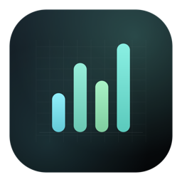
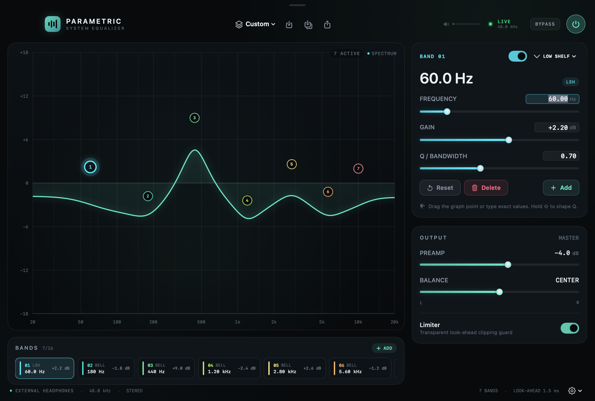

# Parametric EQ



Системный параметрический эквалайзер для macOS: обрабатывает звук **всех приложений**, живёт в Dock и строке меню и не требует виртуального аудиодрайвера или kernel extension.



История версий: [CHANGELOG.md](CHANGELOG.md).

## Плюшки

- **Полностью параметрический EQ** — 10 полос по умолчанию, до 16. У каждой полосы свой тип, частота, gain и Q.
- **7 типов фильтров**: Bell, Low Shelf, High Shelf, Low Pass, High Pass, Notch, Band Pass.
- **Живой график**: точки перетаскиваются, `⇧` + drag меняет Q. Клик по полосе внизу — выбор, двойной клик — включение/выключение.
- **Точный ручной ввод**: частота, gain и Q редактируются как числа (`440`, `1.2k`, `1,2 kHz`, `+3.5`), а не только движками.
- **Спектроанализатор** (vDSP FFT 4096) прямо на графике.
- **Preamp, баланс, look-ahead лимитер, bypass** — всё на месте.
- **Пресеты**: заводские и свои, с сохранением текущей кривой.
- **Импорт AutoEq / Equalizer APO** — вставьте текст или выберите `.txt`.
- **Экспорт AutoEq / Equalizer APO** — текущая кривая или любой пресет в `.txt` из меню.
- **Системный звук целиком** через Core Audio Process Tap: без драйвера, без переключения output-устройства.
- **Dock + menu bar**: иконка в Dock, status item в меню-баре, запуск при логине.
- **Окно не дёргается за движки**: перетаскивание окна — только за верхнюю полоску с «ручкой».
- **Нативный стек**: SwiftUI + Accelerate, DSP быстрее realtime более чем в 300 раз; задержка лимитера ~1.5 мс.
- **Приватность**: звук обрабатывается в памяти и никуда не записывается.
- **MIT**.

## Требования

- macOS **14.2+** (проверено на macOS 26.7.2, Apple Silicon).
- Xcode Command Line Tools + Swift 6.x. Полный Xcode не нужен.
- Разрешение macOS **Screen & System Audio Recording**.

## Сборка

```bash
./build.sh      # dist/Parametric EQ.app
./run.sh        # собрать и открыть
./install.sh    # установить в /Applications (fallback ~/Applications)
./test.sh       # DSP self-tests (68 проверок)
./make_dmg.sh   # dist/ParametricEQ-1.0.1.dmg
```

Приложение подписано ad-hoc. Для локальной сборки этого достаточно; для распространения нужна подпись Developer ID и notarization.

## Первый запуск

1. Откройте приложение и нажмите **Enable** (или кнопку питания справа сверху).
2. Разрешите доступ к системному звуку.
3. Если запрос не появился: **System Settings → Privacy & Security → Screen & System Audio Recording**, включите `Parametric EQ`, вернитесь и нажмите **Retry**.
4. Если старт завис на «Connecting…», через несколько секунд появится карточка с **Settings** и **Retry**.

Сброс разрешения:

```bash
tccutil reset All com.andreyilin.ParametricEQ
```

## Как пользоваться

### Питание

Кнопка питания справа сверху включает и выключает обработку. При выключении оригинальный системный звук возвращается.

### График

- **Перетаскивание точки**: частота и gain.
- **`⇧` + перетаскивание**: Q (ширина полосы).
- **Клик по чипу** внизу: выбрать полосу.
- **Двойной клик по чипу**: включить/выключить полосу.
- **Правый клик по чипу/точке**: дополнительное меню (delete/disable/reset).

### Полосы

В инспекторе справа:

- тип фильтра;
- частота;
- gain (для Bell/Shelf);
- Q / bandwidth;
- enable;
- **Reset**, **Delete**, **Add**.

Значения частоты, gain и Q — это **редактируемые поля**, а не только подписи. Нажмите на число, введите точное значение и нажмите Return. Можно писать `440`, `1.2k`, `1,2 kHz`, `+3.5`, `−2`. Невалидный ввод откатится, значения клампятся в диапазон.

### Выход

- **Preamp** — входной gain до фильтров. Отрицательный preamp оставляет запас под бусты.
- **Balance** — стереобаланс.
- **Limiter** — защита от клиппинга. Лучше держать включённой.
- **Bypass** — быстрый A/B без остановки tap-а.

### Пресеты и экспорт

- Меню пресета в шапке: factory + ваши пресеты.
- Иконка сохранения — сохранить текущую кривую.
- Иконка импорта — AutoEq.
- Иконка **↑** — экспорт текущей кривой в AutoEq/APO.
- В меню пресета и меню-бара есть **Export AutoEq** для текущей кривой и любого сохранённого пресета.
- Шестерёнка в футере: **Reset to Flat**, **Show Spectrum**, **Launch at Login**, **Copy Diagnostics**.

### AutoEq

Импорт поддерживает строки:

```text
Preamp: -6.0 dB
Filter 1: ON PK Fc 105 Hz Gain 5.5 dB Q 0.70
Filter 2: ON LSC Fc 80 Hz Gain 2.0 dB Q 0.70
Filter 3: ON HSC Fc 10000 Hz Gain -1.5 dB Q 0.70
```

Типы: `PK`, `LS/LSC`, `HS/HSC`, `LP`, `HP`, `NO`, `BP`. Можно вставить текст или выбрать `.txt`.

Экспорт даёт такой же формат: `Preamp:` + `Filter N:` строки, `ON/OFF`, POSIX-точка. Его можно скормить AutoEq или Equalizer APO.

### Окно и Dock

- Окно двигается за верхнюю полоску с маленькой «ручкой».
- Закрытие окна не выключает EQ — приложение остаётся в Dock и меню-баре.
- Клик по Dock-иконке возвращает окно.
- «Keep in Dock» — если хотите иконку навсегда.

## Ограничения

- Стерео: на многоканальных устройствах обрабатываются L/R, остальные каналы заглушаются.
- Нет per-app микшера громкости.
- При смене output-устройства движок перезапускается.
- Ad-hoc подпись: после пересборки macOS может попросить разрешение заново.
- Приложение не sandboxed — это нужно для process tap.

## Структура

```
Sources/EQCore/            DSP, модель полос, пресеты, AutoEq
Sources/ParametricEQ/      приложение, Core Audio, SwiftUI
Tests/EQCoreSelfTest/      DSP self-tests
Resources/                 Info.plist, иконка
Scripts/                   генератор иконки
docs/                      скриншот и иконка для README
```

## Лицензия

MIT. См. [LICENSE](LICENSE).
